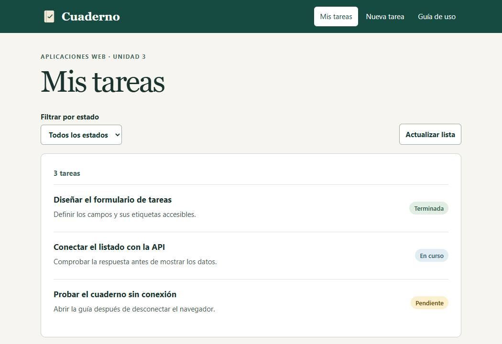
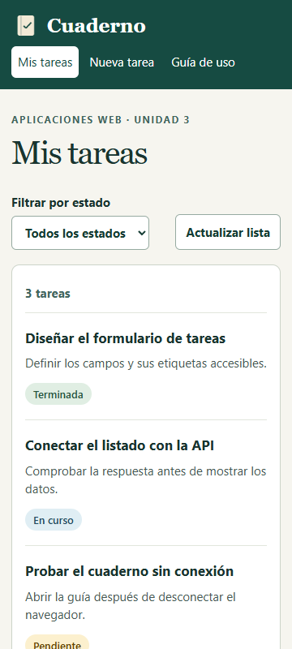

# Pruebas de la entrega

Se ejecutaron tres pruebas automatizadas con Node.js 24 y una base SQLite en memoria. Las tres finalizaron correctamente. Para repetirlas, ejecutar `npm ci` y `npm test`.

| Comprobación realizada en Microsoft Edge | Resultado observado |
|---|---|
| Primera consulta sin registros y actualización con demora controlada | Se mostraron el cuaderno vacío y el mensaje de carga. |
| Alta con el formulario y segunda alta con título repetido | La primera se guardó. La segunda mostró el error 409 y conservó el texto. |
| Filtro sin coincidencias | Se mostró un mensaje específico. |
| Recarga del listado con tres tareas | Las tres tareas seguían disponibles desde SQLite. |
| Respuesta de consulta 503 inducida y reintento | Apareció el error y el reintento recuperó las tres tareas. |
| Ancho de 360 píxeles | Se verificó que el documento no tuviera desbordamiento horizontal. |
| Recarga sin red tras activar el service worker | Abrieron la interfaz y la guía; el botón Guardar quedó deshabilitado. |
| Inspección de Cache Storage y reconexión | Nueve archivos de la interfaz; ningún dato de la API. Al reconectar volvieron las tres tareas. |

